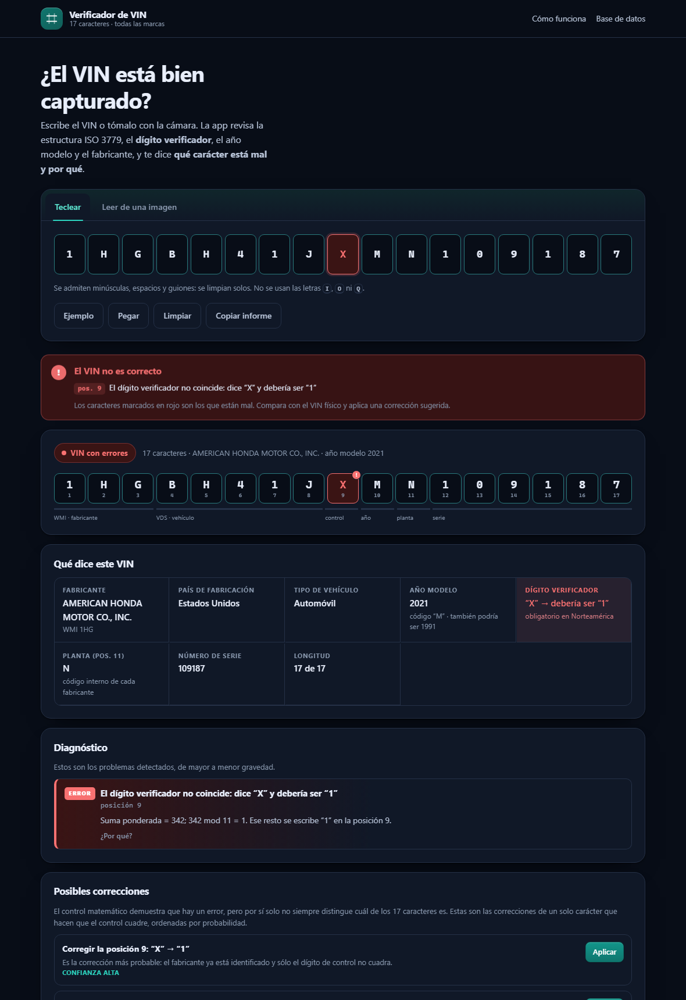
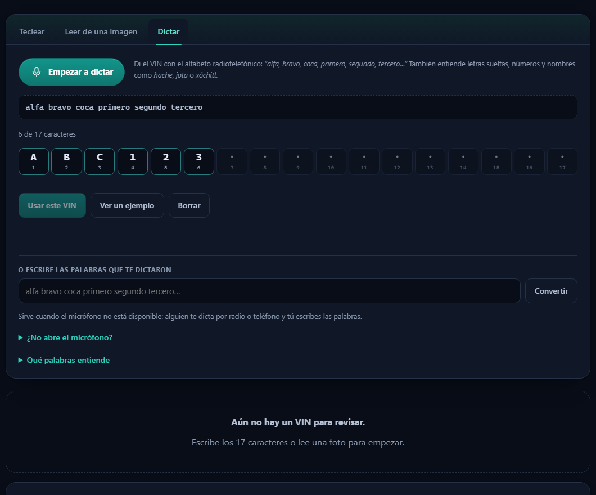

# Verificador de VIN

Aplicación local (sin instalación ni cuenta) para comprobar que un VIN está bien
capturado. Señala **qué carácter está mal y por qué**, decodifica fabricante, país
y año modelo, y permite capturarlo escribiéndolo, leyéndolo de una foto o
**dictándolo** con el alfabeto fonético internacional.

**En línea:** <https://analisisixt.github.io/verificador-vin/> — ábrela desde el
teléfono; al servirse por HTTPS funcionan la cámara y el micrófono.



## Cómo se usa

1. Doble clic en **`INICIAR.cmd`** (Windows). Se abre el navegador en `http://127.0.0.1:8817/`.
2. Escribe el VIN: puede ser en minúsculas, con espacios o guiones, que se limpian solos.
3. Lee el diagnóstico. Cada hallazgo dice la posición, el motivo y la norma que lo sustenta.
   Si algo no cuadra, la app lo marca **en rojo** (el carácter, su casilla y un aviso de alerta
   con el mensaje concreto) y propone correcciones de un solo carácter.
4. Si hay un error, la app propone correcciones de un solo carácter; al aplicar una se
   vuelve a verificar todo.
5. Para la foto: pestaña **Leer de una imagen**, elige o toma la foto, encuadra el VIN y pulsa **Leer el VIN**.
6. Para dictarlo: pestaña **Dictar**, pulsa el micrófono y di el VIN con el alfabeto
   (`alfa, bravo, coca, uno, dos, tres…`). Al completar los 17 caracteres se verifica solo.

También se puede abrir sin el lanzador:

```bash
node server.mjs            # http://127.0.0.1:8817
node server.mjs --open     # y abre el navegador
node server.mjs --host 0.0.0.0   # accesible desde el teléfono en la misma red
```

Enlaces directos:

- `http://127.0.0.1:8817/?vin=1HGBH41JXMN109186`
- `http://127.0.0.1:8817/?dictado=primero%20hache%20golfo%20bravo%20hache%20cuarto%20primero%20julieta%20xochitl%20metro%20nectar%20primero%20negativo%20noveno%20primero%20octavo%20sexto`

## Dictado por voz



Habla con el alfabeto radiotelefónico que se usa en México y la app convierte las
palabras en caracteres. Entiende:

- **Letras:** alfa, bravo, coca, delta, eco, **fox**, **golfo**, hotel, **indio**,
  julieta, kilo, lima, **metro**, **néctar**, oscar, papa, quebec, romeo, sierra,
  tango, **unión**, víctor, whisky, **xóchitl**, yankee, zulu.
- **Números:** **negativo, primero, segundo, tercero, cuarto, quinto, sexto,
  séptimo, octavo, noveno**.
- **Alias:** también acepta los nombres del alfabeto OTAN (foxtrot, golf, india,
  mike, noviembre, uniforme, equis) y los cardinales (cero, uno, dos…), por si el
  reconocedor devuelve uno u otro.
- **Nombres de letra:** hache, jota, ka, ele, eme, ene, pe, cu, erre, uve, ye, zeta.
- **Letras sueltas y VIN pegados:** `1 H G B H 4 1 J X M N 1 0 9 1 8 6` o `1HG-BH41-JXMN109186`.
- **I, O y Q** se interpretan como 1 y 0, igual que al teclearlos.
- Ignora muletillas y separadores («el VIN es…», «guion», «punto»), y avisa de lo que no entendió.

El reconocimiento de voz lo pone el navegador (`SpeechRecognition`): funciona en
**Chrome y Edge**, requiere **micrófono** y **conexión a internet**, y sólo está
disponible en `localhost` o HTTPS (por eso no funciona si abres la app desde otra
computadora por IP y sin TLS). En otros navegadores el botón se desactiva.

### Si el micrófono no abre

La pestaña **Dictar** trae un bloque «¿No abre el micrófono?» que dice exactamente
qué está fallando: conexión segura, API de dictado, permiso del sitio, micrófonos
detectados y el último error. Además, **Probar micrófono** abre el dispositivo y
dibuja el nivel de sonido, para separar «el micrófono no funciona» de «el servicio
de dictado no responde».

Las causas habituales, en orden:

1. **No estás en localhost o HTTPS.** Desde `http://192.168.x.x:8817` el navegador
   bloquea el micrófono. Abre `http://127.0.0.1:8817`.
2. **El navegador no incluye dictado.** Firefox, Brave y algunos Chromium sin
   servicios de Google no traen `SpeechRecognition`. Usa Chrome o Edge.
3. **Permiso del sitio.** Candado de la barra de direcciones → Micrófono → Permitir.
4. **Windows bloquea a las aplicaciones de escritorio.** Configuración → Privacidad
   y seguridad → Micrófono → activar «Acceso al micrófono» y «Permitir que las
   aplicaciones de escritorio accedan al micrófono».
5. **Otro programa usa el micrófono** (Teams, Zoom, Grabador). Ciérralo.
6. **Sin internet o red restringida.** El dictado de Chrome usa un servicio en
   línea; sin salida a la red falla con error de red.
7. **Micrófono equivocado.** Si hay varios, elige el correcto en
   `chrome://settings/content/microphone`.

Si aun así no dicta, **escribe las palabras**: en «O escribe las palabras que te
dictaron» se pega `alfa bravo coca primero segundo tercero…` y se convierte igual
que si lo hubieras dicho. También queda **Ver un ejemplo** para comprobar la
conversión sin micrófono.

## Qué verifica

| Regla | Norma | Qué hace la app |
|---|---|---|
| 17 caracteres exactos | ISO 3779 | Detecta faltantes y sobrantes, e indica cuántos |
| Sin letras I, O, Q | ISO 3779 | Explica por qué no existen y las interpreta como 1 o 0 |
| Estructura WMI / VDS / control / año / planta / serie | ISO 3779 | Pinta los seis bloques sobre el VIN |
| Dígito verificador | 49 CFR 565 | Calcula la suma ponderada, muestra la tabla y compara con la posición 9 |
| Año modelo | 49 CFR 565 | Decodifica el código y desambigua el ciclo de 30 años |
| Fabricante y país | ISO 3780 | Busca el prefijo de 3 caracteres en el registro público de la NHTSA (más de 3 000 prefijos, ampliable) |
| Errores de tecleo | — | Detecta transposiciones de caracteres contiguos y confusiones típicas (O/0, I/1, S/5, B/8…) |

### El detalle que importa

El dígito verificador sólo es obligatorio en **Estados Unidos, Canadá y México**
(49 CFR 565). En Europa, Asia y Sudamérica la posición 9 suele formar parte del
número de serie y no se calcula: la app lo dice y **no marca ese VIN como erróneo**.
Eso es lo que permite usarla con cualquier marca y modelo del mundo.

Cuando el control no cuadra, el cálculo demuestra que **hay al menos un carácter
mal**, pero por sí solo no siempre distingue cuál de los 17 es. Por eso la app:

- muestra la corrección de la propia posición 9 (la más simple);
- calcula, para cada una de las otras 16 posiciones, el único carácter que haría
  cuadrar el control;
- las ordena por probabilidad (confusiones de lectura, años válidos, prefijos de
  fabricante conocidos, dígitos por dígitos) y explica cada una.

## Lectura desde foto (OCR)

Todo ocurre en el navegador, sin subir la imagen a ningún servidor:

1. Se recorta la zona elegida y se normaliza el tamaño.
2. Se generan tres versiones de la imagen: umbral global de Otsu, contraste
   estirado y umbral adaptativo (Bradley) con inversión para placas oscuras.
3. Tesseract.js (WebAssembly, archivos locales) lee cada versión con distintos
   modos de segmentación y un alfabeto restringido a los caracteres válidos del VIN.
4. Cada lectura se puntúa con las reglas del VIN: la que hace cuadrar el dígito
   verificador y reconoce el fabricante gana. Se detiene en cuanto hay una lectura
   convincente.

Consejos: letras grandes en el encuadre, luz uniforme, sin reflejos y la cámara
paralela a la placa.

## Datos

- `app/data/wmi.json`: índice de prefijos WMI (fabricante, país, tipo de vehículo)
  generado a partir del registro público **NHTSA vPIC** (dominio público).
  Cada prefijo ocupa unos pocos bytes; el fabricante se muestra con su nombre registrado.
- La verificación funciona **sin conexión**. Sólo el botón «Consultar NHTSA» usa
  internet, para traer modelo, motor y carrocería de vehículos vendidos en EE. UU.

Para regenerar la base:

```bash
node tools/fetch-wmi.mjs     # descarga el registro completo de la NHTSA (tarda)
node tools/extract-wmi.mjs   # alternativa: extrae la tabla incluida en @kargain/vincent
node tools/build-data.mjs    # construye app/data/wmi.json
```

## Pruebas

```bash
npm test        # motor de VIN + dictado fonético
```

Cubren la transliteración ISO 3779, VIN válidos conocidos, el dígito verificador,
las correcciones de un carácter, las transposiciones, la normalización de I/O/Q,
la longitud, el trato especial a los VIN europeos, el año modelo, la extracción
de candidatos desde texto de OCR y la conversión de frases dictadas
(`alfa bravo coca…`, nombres de letra, números y ruido del reconocedor).

## Privacidad y límites

- Los VIN se procesan en el equipo; no se envía nada a ningún servidor.
- La app verifica **coherencia interna**, no autenticidad: un VIN inventado que
  cumpla el control matemático pasará la prueba. Tampoco detecta VIN clonados.
- El modelo exacto no se puede deducir del VIN en general: los caracteres 4–8 los
  define cada fabricante. Para vehículos de EE. UU. se pueden consultar en la NHTSA.
- La base de fabricantes cubre el registro público; un prefijo ausente se reporta
  como aviso, nunca como error.

## Estructura

```
app/                  aplicación (se sirve tal cual)
  index.html
  assets/styles.css
  src/vin-data.js     constantes normativas y tablas
  src/vin-core.js     motor de validación y diagnóstico (sin DOM)
  src/wmi.js          índice de fabricantes
  src/ocr.js          preprocesado de imagen y OCR
  src/dictation.js    alfabeto fonético y conversión de voz a caracteres
  src/ui.js           interfaz
  data/wmi.json       base de prefijos WMI
  vendor/tesseract/   motor OCR y modelo de letras (local)
server.mjs            servidor estático mínimo
tests/                pruebas del motor
tools/                generación de datos y utilidades
.github/workflows/    publicación automática en GitHub Pages
```

## Publicación

El sitio se publica solo: cada `push` a `main` dispara
`.github/workflows/pages.yml`, que sube la carpeta `app/` como sitio estático en
GitHub Pages (no hace falta servidor: la app es HTML, CSS y JS puro).

- URL: <https://analisisixt.github.io/verificador-vin/>
- Para republicar tras un cambio: `git add -A && git commit -m "…" && git push`
- Para actualizarlo en tu equipo sin publicar: `npm start`

Como GitHub Pages sirve por HTTPS, en el teléfono funcionan la cámara (OCR) y el
micrófono (dictado), que el navegador bloquea en conexiones HTTP que no sean
`localhost`.


